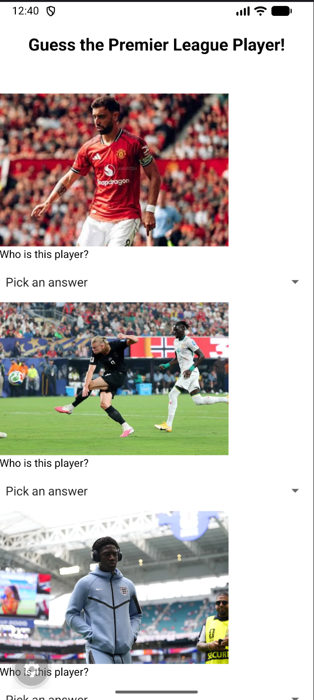
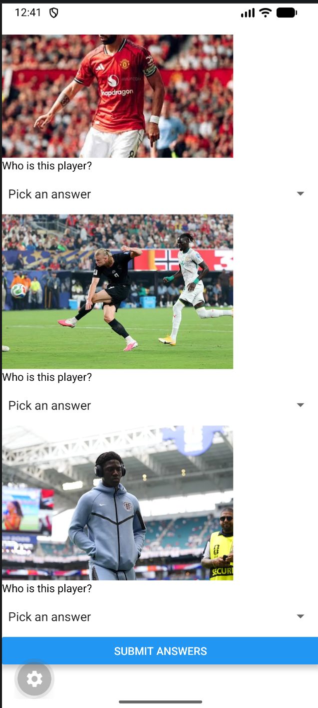
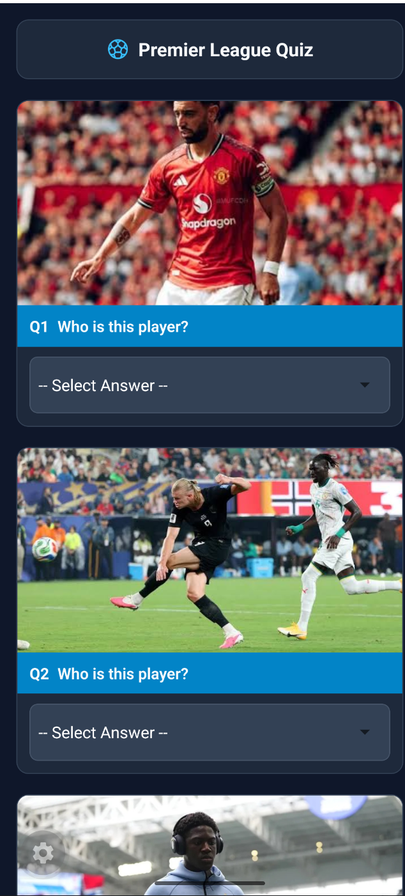
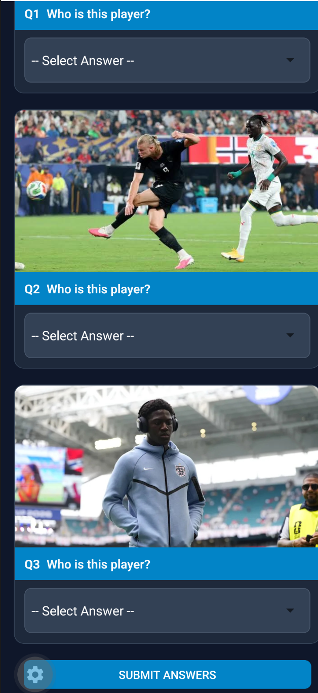

# App Name
Premier League Football Quiz App

## Description
A mobile quiz application built with React Native and Expo that tests users' knowledge of English Premier League players using interactive picker dropdowns, custom images, and score validation.

## Screenshots of App BEFORE applying Stylesheet changes
Screenshots:
- 
- 

## Screenshots of App AFTER applying Stylesheet changes
Screenshots:
- 
- 

## Link to Demo Video with audible narration explaining styling changes with code reference
Demo Video Link:
IN POLITEMALL SUBMISSION